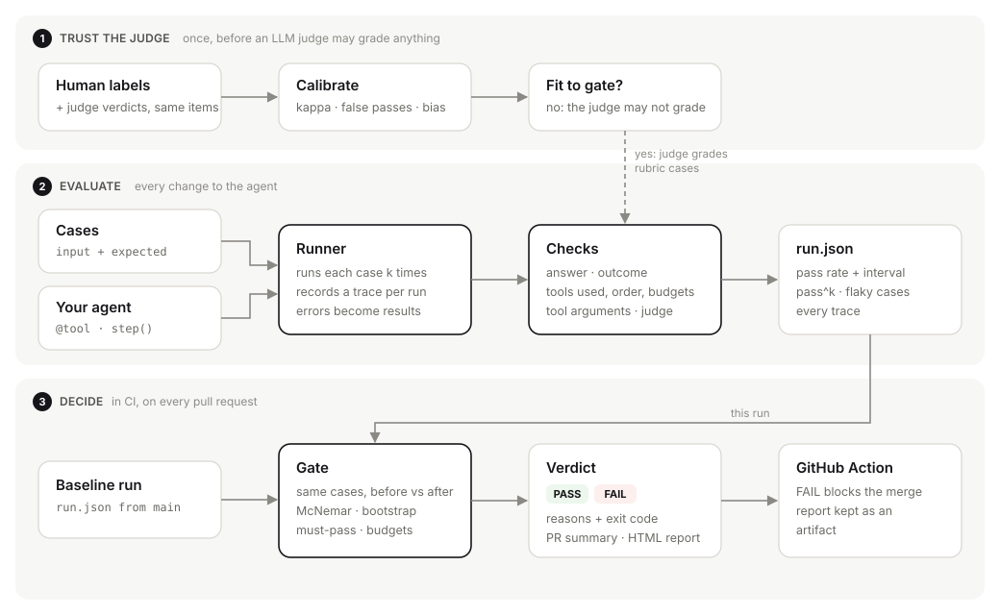

# Architecture

holdline answers one question on every change to an agent: **is it measurably worse?** It does
that in three steps, each a plain function over plain files.



1. **Trust the judge** (once). If any case is graded by an LLM judge, compare the judge with human
   labels first. A judge that is not fit is not allowed to grade.
2. **Evaluate** (every change). Run each case k times, record what the agent did, grade every
   run, save a `run.json`.
3. **Decide** (in CI). Compare this run with a baseline run case by case and return PASS or FAIL
   with the reasons.

Every arrow in the diagram is a file you can open: `cases.jsonl`, `run.json`, `labels.jsonl`.
There is no server and no database.

## Components

| Module | Job | Key idea |
|---|---|---|
| `trace.py` | Record what the agent did | A `contextvars` slot holds the trace of the run in progress. `@holdline.tool` and `holdline.step()` append to it, and do nothing outside a run |
| `suite.py` | Load and validate cases | JSON, JSONL or YAML; unknown keys and bad outcomes are rejected with the case id, before anything runs |
| `checks.py` | Grade one run | Built-in checks are switched on by keys in `expected`; custom checks are plain functions; any exception becomes a failed check |
| `runner.py` | Run the suite | Thread pool over (case, repeat) jobs; sync or async targets; each job gets its own trace; summary statistics |
| `stats.py` | The numbers | Wilson interval, pass@k and pass^k, exact McNemar, paired and cluster bootstrap, Cohen's kappa with an interval. Standard library only, seeded |
| `judge.py` | Measure the judge | `llm_judge()` wraps any `prompt -> text` call; `calibrate()` returns agreement, kappa, false-pass rate, bias per group, sign reversal, a held-out threshold and a fit verdict |
| `gate.py` | Decide | Pairs cases by id, tests the flips, applies the practical rules, returns reasons and warnings |
| `report.py`, `html_report.py` | Show it | Terminal text, Markdown for the pull request, one self-contained HTML file |
| `cli.py`, `action.yml` | Run it in CI | `holdline run / gate / calibrate / report / show`; the composite Action wires `run` and `gate` and writes the job summary |

## What happens in one run

```
for each (case, repeat) in a thread pool:
    trace = new Trace(case.id, repeat)        # bound to this context only
    output = target(case.input)               # the agent records steps into trace
    if it raised: trace.error = the exception # the run fails; the suite goes on
    checks = evaluate(case, trace)            # ran, outcome, answer, tools, budgets, args, judge, custom
    passed = all(checks)
summary = pass rate (bootstrap over cases), pass^k, flaky cases, must-pass failures,
          held back when it should, answered when it should, latency, tokens, cost
save run.json (meta + suite snapshot + summary + every result with its trace)
```

**Outcome.** Every run ends in `answer`, `abstain` or `escalate`. holdline reads it from
`output["outcome"]`, else from the last `decision` step, else from whether the output is empty.
Knowing when not to act is measured on its own: the share of should-not-answer cases where the
agent held back, and the share of answerable cases where it did answer.

## How the gate decides

```
paired cases = ids present in both runs
a case passes = all its repeats passed
regressions = passed before, fails now     fixes = failed before, passes now
McNemar exact p on (regressions, fixes)
bootstrap interval on mean(candidate fraction - baseline fraction) over cases
FAIL if: significant regression | drop > max_drop | a must-pass case fails |
         pass rate < min | held back < floor | p95 latency or cost over budget
```

Small suites rarely reach significance (4 broken and 0 fixed is p = 0.125), so must-pass cases and
a maximum drop sit next to the test. A regression that is not significant is a warning, not
silence.

## How the judge is measured

For each labelled item: the human verdict, the judge verdict, optionally a group and a judge
score. From those:

- **Cohen's kappa** with a bootstrap interval (agreement corrected for chance);
- **false-pass rate**, the judge passing what a human failed: the error that lets a regression ship;
- **bias** (judge pass share minus human pass share), overall and per group, and a **sign
  reversal** flag when the judge is lenient on one group and harsh on another;
- a **score threshold** chosen on one half of the labels and reported on the other.

Fit to gate means: at least 30 items, kappa lower bound at least 0.6, false-pass rate at most
10%, no sign reversal. All four are options.

## Concurrency, determinism, failure

- Jobs run on a thread pool (`--workers`). Agent code that is not thread-safe can use `--workers 1`.
- Async targets are run with `asyncio.run` per job.
- Timeouts are soft: Python cannot kill a thread safely, so a slow run is marked failed after it
  returns.
- Every resampling step is seeded, so the same run files give the same report and verdict.
- An exception anywhere (target, check, judge) is recorded and fails that run only.

## Extending it

- A new check: `@holdline.check("name")` on `fn(case, trace)`, then list it in `expected.checks`.
- A new judge: any function `judge(case, trace) -> bool | score | dict`.
- A framework adapter: map the framework's callbacks to `holdline.step()` (see
  `examples/helpdesk/target.py`, which maps helpdesk-agent's step events).
- Another observability stack: `trace.to_otel()` produces OTLP/JSON with GenAI attribute names.

## Trade-offs, on purpose

| Chose | Over | Because |
|---|---|---|
| Standard library only | numpy, scipy, pydantic | installs into any agent environment without conflicts |
| Files | a database or server | diffable, reviewable in a pull request, nothing to host |
| Threads | processes | shared clients and no pickling; soft timeouts are the cost |
| Exact tests and bootstrap | normal approximations | eval suites are small; approximations lie at small n |
| Binary case verdicts in the gate | score averages | a merge decision is binary, and every failure carries a reason |

Every decision, with the alternatives considered, is in [DECISIONS.md](DECISIONS.md).
